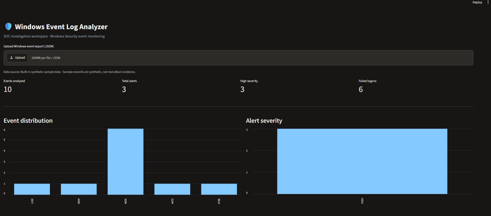
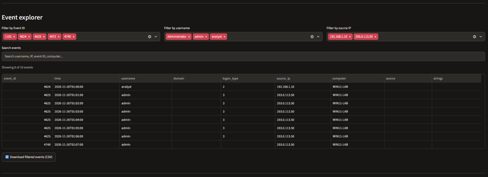
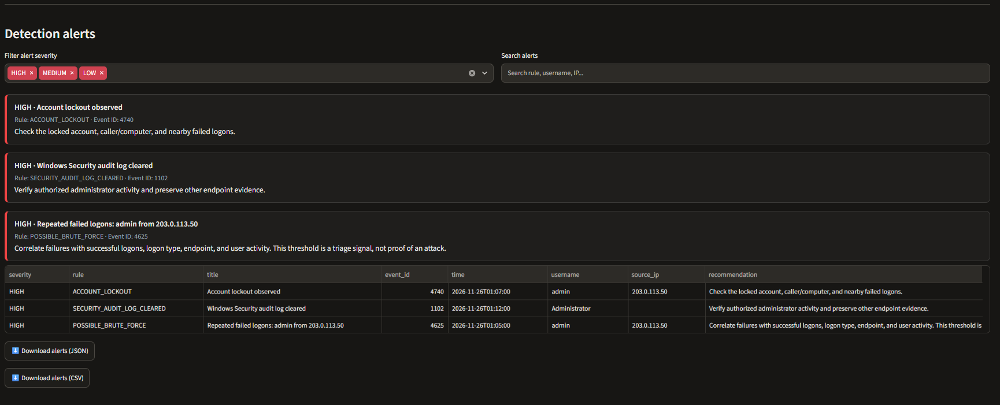
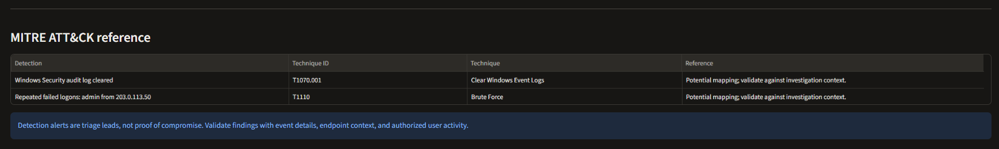

# Windows Event Log Analyzer

A defensive Windows 10/11 SOC portfolio project that collects selected Windows Security events, normalizes event data, applies baseline detection rules, and presents investigation leads in a Streamlit dashboard.

> **Project status:** Portfolio prototype / active learning project. Alerts are triage leads, not proof of compromise. Validate every finding with event details and endpoint context.

## Features

- Collect selected Windows Security events from an authorized Windows host.
- Normalize event fields for analysis and investigation.
- Detect repeated failed logons (Event ID 4625) when 5 or more failures for the same account and source IP occur within 10 minutes.
- Alert on account lockouts (4740), Security audit log clearing (1102), user creation (4720), and selected security-group membership changes (4728, 4732, 4756).
- Keep successful logons (4624), logoffs (4634), special-privilege events (4672), and explicit-credential events (4648) available for contextual review rather than treating them as standalone malicious activity.
- Streamlit dashboard with severity-based alert cards, event filters, search, and CSV/JSON exports.
- Basic MITRE ATT&CK references for applicable detections.
- Unit tests for core detection behavior.

## Tech stack

- Python
- Pandas
- Streamlit
- pywin32 (Windows event collection)
- Windows Security Event Logs
- MITRE ATT&CK references

## Dashboard screenshots

The dashboard uses synthetic sample data for this public demonstration. These screenshots show the main investigation views.

### Dashboard overview



### Event explorer



### Detection alerts



### MITRE ATT&CK reference



## Project structure

```text
analyzer/       Event normalization, detection rules, CLI analysis
collector/      Windows Security event collection
config/         Detection threshold settings
dashboard/      Streamlit SOC investigation dashboard
sample_logs/    Synthetic sample events for safe demonstration
tests/          Unit tests
data/           Local event exports (not committed)
reports/        Generated reports (not committed)
```

## Setup (Windows PowerShell)

Run these commands from the repository root:

```powershell
py -3 -m venv venv
.\venv\Scripts\Activate.ps1
python -m pip install --upgrade pip
pip install -r requirements.txt
```

## Run with synthetic sample data

Analyze the included sample events:

```powershell
python -m analyzer.analyze --input sample_logs\sample_events.json
```

Launch the dashboard:

```powershell
$env:PYTHONPATH = (Get-Location).Path
python -m streamlit run dashboard\app.py
```

Open the local URL printed by Streamlit (normally `http://localhost:8501`).

## Collect real Windows Security events

Use only a Windows system you own or are explicitly authorized to administer. Open PowerShell as Administrator in the repository root:

```powershell
python -m collector.collect_events --hours 24 --limit 5000
python -m analyzer.analyze --input data\events.json
```

The collector writes to `data/events.json`. This file is intentionally excluded from Git because real Windows logs can contain usernames, hostnames, IP addresses, and other sensitive details.

## Detection logic

| Event / condition | Baseline behavior |
|---|---|
| 4625 | Possible brute-force alert at 5 failures for the same account + source IP within 10 minutes |
| 4740 | High-severity account-lockout alert |
| 1102 | High-severity Security audit log-cleared alert |
| 4720 | High-severity user-account-created alert |
| 4728, 4732, 4756 | High-severity security-group membership change alerts |
| 4624, 4634 | Retained as normal login/logoff telemetry |
| 4672, 4648 | Retained for contextual investigation; no standalone alert by default |

The brute-force threshold is a configurable baseline in `config/settings.json`. Confirm the meaning of event fields on the target Windows version and correlate detections with surrounding activity.

## Run tests

```powershell
python -m unittest discover -s tests -v
```

## Privacy and safe use

- Do not commit raw exports from `data/` or generated reports containing real endpoint details.
- Do not publish usernames, hostnames, internal IP addresses, SIDs, or other identifying log content.
- Use synthetic or sanitized data for screenshots and public demonstrations.
- Use this project only for defensive monitoring on systems you own or are authorized to assess.

## Future improvements

- Add a dedicated detection-testing lab with positive and negative test scenarios.
- Improve event parsing using structured Windows Event XML and validate field mappings across Windows versions.
- Expand detection coverage, correlation, and test cases.
